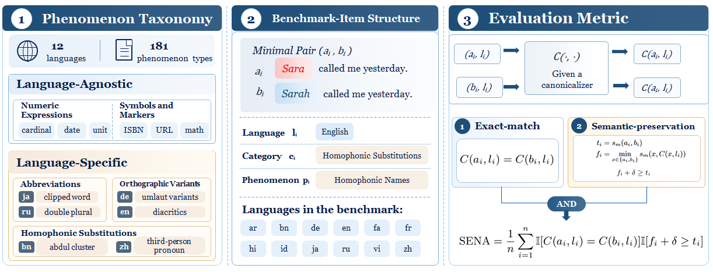

<p align="center">
  <picture>
    <source media="(prefers-color-scheme: dark)" srcset="./assets/readme/etc-bench-logo-dark.png">
    
  </picture>
</p>

<h1 align="center">ETC-Bench</h1>

<p align="center"><strong>面向评测侧转写文本规范化的多语种基准</strong></p>

<p align="center">
<a href="https://zh-qian2004.github.io/etc-bench/demo/"><strong>交互演示 ↗</strong></a> ·
<a href="https://arxiv.org/abs/2610.36527"><strong>论文 ↗</strong></a> ·
<a href="#快速开始"><strong>快速开始</strong></a> ·
<a href="#tacs"><strong>TACS</strong></a> ·
<a href="#小模型规范化器"><strong>模型</strong></a>
</p>

<p align="center"><a href="README.md">English</a> · <strong>简体中文</strong></p>

<p align="center">
<a href="#什么是-etc">什么是 ETC？</a> · <a href="#仓库内容">资源</a> ·
<a href="#etc-bench">Benchmark</a> · <a href="#sena">指标</a> ·
<a href="#引用">引用</a>
</p>

---

ETC-Bench 是用于评测 **evaluation-side transcript canonicalization（ETC，评测侧转写文本规范化）** 的多语种 benchmark。它检验语音等价的 transcript variants 能否得到完全相同的 canonical output，同时限制明显的附带语义变化。

<p align="center"><strong>1,098</strong> 个最小对 &nbsp;·&nbsp; <strong>181</strong> 个现象 &nbsp;·&nbsp; <strong>12</strong> 种语言 &nbsp;·&nbsp; <strong>5</strong> 个类别</p>

<p align="center"><a href="./assets/readme/etc-bench-overview.png"></a></p>

## 什么是 ETC？

Evaluation-side transcript canonicalization（ETC）是在比较系统转写和参考转写之前，将同一语音的多种有效书面形式映射到统一 canonical form 的任务。同一个 canonicalizer 分别、独立地处理两侧文本。

语音并不总能唯一决定书面转写。数字、缩写、拼写变体、符号和同音表达，都可能让同一句语音产生不同但有效的书面形式。直接比较文本时，这种表达选择可能被错误计为系统错误。

例如：

| 转写 A | 转写 B | 统一 canonical form |
|---|---|---|
| `The recipe calls for two eggs.` | `The recipe calls for 2 eggs.` | `The recipe calls for 2 eggs.` |

ETC 不规定目标形式必须遵循传统文本规范化（TN）还是逆文本规范化（ITN）。只要目标 canonical form 确定且保留相关语义信息，两种方向都可以作为 ETC 的实现方式。

## 仓库内容

| 组件 | 用途 |
|---|---|
| [`benchmark/`](benchmark/) | ETC-Bench：1,098 个语音等价最小对 |
| [`evaluation/`](evaluation/) | 统一的输入准备、格式验证和 SENA 评测 |
| [`tools/tacs/`](tools/tacs/) | Taxonomy-Guided Agent Canonicalization Skill |
| [`tools/model-canonicalizer/`](tools/model-canonicalizer/) | 4B 和 0.8B 小模型规范化器的推理代码 |
| [`demo/`](demo/) | 用于浏览样本和 canonicalizer 输出的静态[交互演示](https://zh-qian2004.github.io/etc-bench/demo/) |
| [`CITATION.cff`](CITATION.cff) | 机器可读的引用信息 |

## ETC-Bench

每条 benchmark 样本都是一个共享句子上下文中的最小对。两侧仅在目标 span 上存在差异，并对应一个 canonicalization phenomenon。

### 类型体系

| Category | 范围 | 所描述的变化 |
|---|---|---|
| Numeric Expressions | Language-agnostic | 数字的书写格式与口语实现 |
| Symbols & Markers | Language-agnostic | 非单词符号表达式与标记 |
| Abbreviations | Language-specific | 单词缩写与完整形式 |
| Orthographic Variants | Language-specific | 同一单词的不同书写形式 |
| Homophonic Substitutions | Language-specific | 无法由语音确定的书面区别 |

<details>
<summary><strong>语言覆盖与样本数</strong></summary>

| 代码 | 语言 | 样本对 | 代码 | 语言 | 样本对 |
|---|---|---:|---|---|---:|
| `ar` | 阿拉伯语 | 86 | `hi` | 印地语 | 100 |
| `bn` | 孟加拉语 | 98 | `id` | 印度尼西亚语 | 98 |
| `de` | 德语 | 93 | `ja` | 日语 | 76 |
| `en` | 英语 | 88 | `ru` | 俄语 | 100 |
| `fa` | 波斯语 | 80 | `vi` | 越南语 | 98 |
| `fr` | 法语 | 89 | `zh` | 汉语普通话 | 92 |

</details>

<details>
<summary><strong>样本字段</strong></summary>

`benchmark/` 中每个语言文件均为 UTF-8 JSONL。每条样本包含：

```json
{
  "id": "2291",
  "language": "en",
  "category": "symbols_markers",
  "phenomenon": "biological",
  "phenomenon_description": "A biological classification written as a code that is read aloud as a name.",
  "a": "They were treated for HPV.",
  "b": "They were treated for H P V."
}
```

- `id`：release 中唯一的样本编号；
- `language`：ISO 639-1 语言代码；
- `category`：五个 taxonomy category 之一；
- `phenomenon`：canonicalization phenomenon 标识；
- `phenomenon_description`：现象的自然语言定义；
- `a`、`b`：需要独立处理的最小对两侧文本。

[`benchmark/manifest.json`](benchmark/manifest.json) 记录 release 文件、版本、行数和 SHA-256 校验和。

</details>

## 快速开始

推荐使用 Python 3.11。

```bash
git clone https://github.com/zh-qian2004/etc-bench.git
cd etc-bench
python -m venv .venv
source .venv/bin/activate
pip install -r requirements.txt
```

### 1. 准备相互独立的两侧输入

```bash
python evaluation/prepare_inputs.py --output-dir work/input
```

该命令分别打乱并输出 `input-a.jsonl` 和 `input-b.jsonl`，同时生成用于组装结果的私有 manifest。不要把 `_manifest.jsonl` 暴露给规范化系统。

统一的输入格式为：

```json
{"id":"opaque-id","language":"en","text":"The recipe calls for two eggs."}
```

### 2. 分别规范化两侧输入

任何 ETC 系统都可以接入。例如，使用公开的 4B 模型：

```bash
python tools/model-canonicalizer/predict.py \
  --model zhiheng-qian/etc-qwen3.5-4b \
  --input work/input/input-a.jsonl \
  --out work/output-a.jsonl \
  --device auto --batch-size 16

python tools/model-canonicalizer/predict.py \
  --model zhiheng-qian/etc-qwen3.5-4b \
  --input work/input/input-b.jsonl \
  --out work/output-b.jsonl \
  --device auto --batch-size 16
```

每条输出必须保留输入 ID：

```json
{"id":"opaque-id","canonical_text":"The recipe calls for 2 eggs.","status":"ok","error":null}
```

### 3. 验证并计算指标

```bash
python evaluation/validate_predictions.py \
  work/input/input-a.jsonl work/output-a.jsonl

python evaluation/validate_predictions.py \
  work/input/input-b.jsonl work/output-b.jsonl

python evaluation/evaluate_sena.py \
  --manifest work/input/_manifest.jsonl \
  --pred-a work/output-a.jsonl \
  --pred-b work/output-b.jsonl \
  --output work/sena.json
```

评测器首次运行时会下载 `xlm-roberta-large`。完整 benchmark 的 SENA 计算建议使用 GPU。简明实验协议和语言子集参数见 [`evaluation/README.md`](evaluation/README.md)。

## SENA

**Semantic-Preserving Exact-Match Normalization Accuracy（SENA）** 仅在以下两个条件同时满足时为一个样本计分：

1. 最小对两侧独立处理后的 canonical text 完全相等；
2. 相对于原始样本对的 BERTScore，规范化前后的相似度下降不超过允许范围。

评测器报告总体以及按语言、category 和 phenomenon 划分的 SENA。论文配置使用 `xlm-roberta-large`，不使用 IDF weighting 和 baseline rescaling，采用原始字符串完全匹配，并固定 `delta=0.10`。

## TACS

[`tools/tacs/`](tools/tacs/) 提供 **Taxonomy-Guided Agent Canonicalization Skill（TACS）**，其中包含：

- 封闭的 language-agnostic 与 language-specific phenomenon 集合；
- 按语言组织的 canonicalization contracts；
- 五阶段现象识别与局部编辑方法；
- batch 输入、输出、trace 和验证约定。

TACS 是提供给 agent 的方法论 skill，agent 本身仍然负责求解。附带脚本只负责文件验证和 benchmark 隔离检查，不会作为规则系统直接生成答案。

论文使用三种不同 agent model 实例化 TACS。下表报告三次独立运行的 ETC-Bench SENA 均值：

| 系统 | Agent model | 运行次数 | ETC-Bench SENA |
|---|---|---:|---:|
| TACS–GPT | GPT-5.6-Terra | 3 | 43.3 |
| TACS–DeepSeek | DeepSeek-V4-Flash | 3 | 43.8 |
| TACS–Qwen | Qwen3.8-Flash | 3 | 68.8 |

```text
Use $taxonomy-guided-agent-canonicalization-skill.

Canonicalize the UTF-8 JSONL records in:
{{input_path}}

Write the validated JSONL results to:
{{output_path}}
```

完整调用 prompt 与目录说明见 [`tools/tacs/README.md`](tools/tacs/README.md)。

## 小模型规范化器

我们公开两个基于 Qwen3.5 微调的 ETC canonicalizer：

| 模型 | 基础模型 | Epochs | ETC-Bench SENA | 权重 |
|---|---|---:|---:|---|
| ETC-Qwen3.5-4B | Qwen3.5-4B | 3 | 59.2 | [Hugging Face](https://huggingface.co/zhiheng-qian/etc-qwen3.5-4b) |
| ETC-Qwen3.5-0.8B | Qwen3.5-0.8B | 3 | 43.6 | [Hugging Face](https://huggingface.co/zhiheng-qian/etc-qwen3.5-0.8b) |

两个模型均使用 greedy decoding，并关闭 thinking。推理时使用的完整指令保存在 [`tools/model-canonicalizer/prompt.txt`](tools/model-canonicalizer/prompt.txt)；为保证复现，其中保留了训练时的原始术语。本 release 不包含训练代码、optimizer state 和中间 checkpoint。

<details>
<summary><strong>训练数据与公共设置</strong></summary>

训练数据来源包括：

- 32,718 条经 teacher canonicalization 的 FLEURS train 数据；
- 8,735 条经 teacher canonicalization 的 FLEURS test 数据；
- 8,547 条未进入 ETC-Bench release 的同分布生成池数据。

构建生成池训练部分时排除了 release 中出现的 ID、样本对和完整转写文本。训练时仅保留 `0.3` 比例的 no-op 样本。公共设置为三个 epoch、随机种子 `42`、最大序列长度 `512` 和只在回答部分计算的监督损失。

</details>

推理支持 CUDA、Ascend NPU 和 CPU；只有 Ascend NPU 需要 `torch_npu` 与 CANN。模型标识和更多推理说明见 [`tools/model-canonicalizer/`](tools/model-canonicalizer/)。

## 仓库结构

```text
etc-bench/
├── assets/readme/              # README Logo 素材
├── benchmark/                  # Release JSONL 与 manifest
├── demo/                       # 静态交互演示
├── evaluation/                 # 统一 SENA 评测
├── tools/
│   ├── tacs/                   # Agent skill、taxonomy 与 contracts
│   └── model-canonicalizer/    # 小模型推理代码
├── CITATION.cff
├── README.md
└── README.zh-CN.md
```

## 引用

如果 ETC-Bench、SENA、TACS 或公开的 canonicalizer 对你的研究有帮助，请引用[我们的论文](https://arxiv.org/abs/2610.36527)：

```bibtex
@misc{qian2026etcbench,
  title={ETC-Bench: A Multilingual Benchmark for Evaluation-Side Transcript Canonicalization},
  author={Zhiheng Qian and Junhao Du and Jing Peng and Hanqi Li and
    Kunyang Peng and Feng Xue and Kai Yu},
  year={2026},
  eprint={2610.36527},
  archivePrefix={arXiv},
  primaryClass={cs.CL},
  url={https://arxiv.org/abs/2610.36527}
}
```

机器可读的引用信息见 [`CITATION.cff`](CITATION.cff)。
